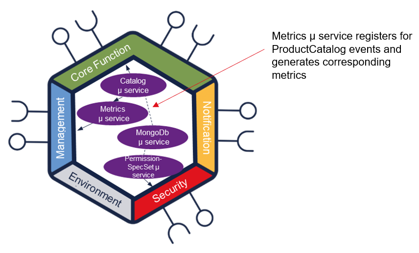

# Tutorial: deploy and observe a running component

This tutorial deploys a product catalog ODA Component into a Canvas, and then observes its business metrics, technical metrics and traces with the reference observability stack: Prometheus, Grafana, Jaeger and the OpenTelemetry Collector.

It follows the same steps as [Observability in the ODA Canvas](https://youtu.be/3Mcv0oc-0rs), part 5 of the [ODA Canvas training videos](../training-videos/part-5.md). For the design behind it, see the [Observability design](../../canvas/Observability-design.md).

## Before you start

You need:

* A Kubernetes cluster with the ODA Canvas installed. See [Installing the ODA Canvas](../../canvas/installation/README.md).
* `kubectl`, `helm` and `python` on your machine.
* A clone of the [oda-canvas](https://github.com/tmforum-oda/oda-canvas) repository. The commands below are run from its root folder.
* At least 4 GB of free memory in the cluster for the observability stack.

## How it works

A component declares its metrics API in the `managementFunction` of its specification, with `apiType: openmetrics` (or `prometheus`). When the component is deployed, the Canvas's API operator creates a `ServiceMonitor` for that API, and Prometheus starts scraping it every 15 seconds. Traces work the other way round: the component pushes them over OTLP to the OpenTelemetry Collector, which forwards them to Jaeger.

```
Component /metrics endpoint  <── scraped by ──  Prometheus (via the ServiceMonitor)  ──>  Grafana
Component traces  ── OTLP HTTP :4318 ──>  OpenTelemetry Collector  ──>  Jaeger
```

## Step 1: Install the observability stack

The [observability stack chart](../../canvas/charts/observability-stack/README.md) installs Prometheus (with the Prometheus operator), Grafana, Jaeger and the OpenTelemetry Collector into the `monitoring` namespace:

```bash
helm repo add prometheus-community https://prometheus-community.github.io/helm-charts
helm repo add opentelemetry https://open-telemetry.github.io/opentelemetry-helm-charts
helm repo add jaegertracing https://jaegertracing.github.io/helm-charts
helm repo update
helm dependency build charts/observability-stack
helm install observability charts/observability-stack --create-namespace --namespace monitoring
```

Check that the pods are running:

```bash
kubectl get pods -n monitoring
```

## Step 2: Configure the Canvas to create ServiceMonitors

The API operator's `openMetricsImplementation` setting decides how metrics collection is configured. The reference stack needs `ServiceMonitor`, but the `canvas-oda` chart sets `PrometheusAnnotation` by default, so change it for the API operator you use. For example, for Istio:

```bash
helm upgrade canvas charts/canvas-oda -n canvas --reuse-values \
  --set api-operator-istio.deployment.openMetricsImplementation=ServiceMonitor
```

For Kong the value is `api-operator-kong.deployment.openMetricsImplementation`, and for Apache APISIX it is `api-operator-apisix.deployment.openMetricsImplementation`. Only components deployed after the change get a `ServiceMonitor`.

## Step 3: Deploy a component that sends traces to the collector

Install the product catalog test component from the test kit, as release `obs`:

```bash
helm install obs feature-definition-and-test-kit/testData/productcatalog-v1 -n components
```

Its metrics API is declared in its component specification:

```yaml
managementFunction:
  exposedAPIs:
  - name: metrics
    apiType: prometheus
    implementation: {{.Release.Name}}-{{.Values.component.name}}-sm
    path: /{{.Release.Name}}-{{.Values.component.name}}/metrics
    port: 4000
```

The collector address is not part of the component specification. It is set at install time, in the component's Helm values, and this test chart already points at the reference stack's collector:

```yaml
api:
  otlp:
    protobuffCollector:
      enabled: true
      url: http://observability-opentelemetry-collector.monitoring.svc.cluster.local:4318/v1/traces
```

If you installed the stack with a different release name or namespace, change the URL with `--set api.otlp.protobuffCollector.url=...`.

## Step 4: Check that the Canvas created the ServiceMonitor

```bash
kubectl get exposedapis -n components
kubectl get servicemonitors -n components
```

The component has three exposed APIs, and one of them is `metrics`. The Canvas has created a ServiceMonitor for it, `obs-productcatalogmanagement-metrics`, which points at the metrics path on port 4000 with an interval of 15 seconds. Nobody had to configure Prometheus by hand. When you uninstall the component, the ServiceMonitor is removed with it.

## Step 5: Generate some traffic

The component's business metrics count the catalog events it handles. The [canvas-ops-tutorial skill](https://github.com/tmforum-oda/oda-canvas/tree/main/skills/canvas-ops-tutorial) includes a script that creates and deletes categories, catalogs, product specifications and product offerings. Find the product catalog API's URL in the output of `kubectl get exposedapis -n components`, then run, for example:

```bash
python skills/canvas-ops-tutorial/scripts/exercise_catalog_api.py https://localhost/obs-productcatalogmanagement/tmf-api/productCatalogManagement/v4 --rounds 3
```

Each round creates about 14 resources and deletes half of them. Run it a few more times while you work through the next steps, and use `--cleanup` at the end to delete what it created.

## Step 6: Explore the metrics in Prometheus

```bash
kubectl port-forward svc/observability-prometheus-prometheus 9090:9090 -n monitoring
```

Open http://localhost:9090.

1. Go to **Status > Target health** and filter for `obs`. The `obs-productcatalogmanagement-sm` target is **UP**: Prometheus picked it up from the ServiceMonitor within seconds of the component being deployed.
2. Go to **Query**, and show the rate of each kind of business event in the **Graph** tab, with a 15 minute range:

   ```
   sum by (NotificationEvent) (rate({__name__=~".+_api_counter", namespace="components"}[5m]))
   ```

   The counter has a label, `NotificationEvent`, for each kind of event, such as `CategoryCreationNotification`. In the current component images its name starts with the component instance name, for example `obs_productcatalogmanagement_api_counter`; older images use `product_catalog_api_counter`.
3. Technical metrics need nothing from the component. The platform already reports the CPU and memory of every container:

   ```
   sum by (pod) (rate(container_cpu_usage_seconds_total{namespace="components"}[5m]))
   ```


## Step 7: Build a dashboard in Grafana

```bash
kubectl port-forward svc/observability-grafana 3000:80 -n monitoring
```

Open http://localhost:3000 and log in as `admin`. Read the password from its secret:

```bash
kubectl get secret observability-grafana -n monitoring -o jsonpath="{.data.admin-password}" | base64 -d
```

Grafana uses Prometheus as its data source. To see one component's business and technical metrics side by side, import the [ODA Component dashboard](https://github.com/tmforum-oda/oda-ca-docs/blob/main/Observability-Tutorial/oda-component-dashboard.json): go to **Dashboards > New > Import** and upload the JSON file. Choose the component's metrics API at the top of the dashboard. Its panels are:

* **Metrics endpoint**: whether Prometheus can scrape the component.
* **Business events** and **Events by type**: the events in the last 15 minutes.
* **Business events per minute**, by type.
* **CPU by pod** and **Memory by pod**, for the component's running pods.

The dashboard is not specific to the product catalog: it works for any component whose metrics include a counter ending in `_api_counter`. The stack also comes with the standard Kubernetes dashboards. Open **Kubernetes / Compute Resources / Namespace (Pods)** and choose the `components` namespace to see the CPU and memory of every deployed component together.

## Step 8: Follow a request in Jaeger

```bash
kubectl port-forward svc/observability-jaeger-query 16686:16686 -n monitoring
```

Open http://localhost:16686. Choose the `obs-productcatalogmanagement` service and click **Find Traces**. Each trace is one API request, and the chart at the top shows how long each one took, so a slow or failing request stands out.

Open a trace to see the request from end to end: the incoming HTTP call, the middleware steps that validate the request against the TMF API definition, and the calls to the database, each with how long it took.


If no traces appear, check the collector URL that the component is using:

```bash
kubectl get deploy obs-prodcatapi -n components -o jsonpath="{.spec.template.spec.containers[0].env[?(@.name=='OTL_EXPORTER_TRACE_PROTO_COLLECTOR_URL')].value}"
```

## How a component creates business metrics

To expose business metrics, a component provides a metrics endpoint in the OpenMetrics (Prometheus) format. In the product catalog component, a metrics microservice registers for the catalog's events, using the Open API pub/sub mechanism, and counts them with the `prom-client` library for Node.js. There are client libraries for most popular programming languages.



Prometheus supports these metric types:

* A **counter** only goes up (or is reset to zero on restart). Use it for the number of requests served, tasks completed or errors.
* A **gauge** can go up and down. Use it for measured values such as memory use, or counts such as the number of concurrent requests.
* A **histogram** counts observations, such as request durations or response sizes, in configurable buckets, and gives the sum of all observed values.

The source of the component is in the [reference example components](https://github.com/tmforum-oda/reference-example-components) repository.

## Clean up

```bash
python skills/canvas-ops-tutorial/scripts/exercise_catalog_api.py https://localhost/obs-productcatalogmanagement/tmf-api/productCatalogManagement/v4 --cleanup
helm uninstall obs -n components
kubectl get servicemonitors -n components
```

The ServiceMonitor has gone with the component. To remove the observability stack too, run `helm uninstall observability -n monitoring`.

## Testing it with BDD features

The test kit checks this behaviour automatically. UC012-F002 installs a component and checks that a ServiceMonitor is created, then removed on uninstall (tag `@ServiceMonitor`). UC012-F001 adds catalog data and checks that new events reach the OpenTelemetry Collector (tag `@OpenTelemetryCollector`). See the [Observability design](../../canvas/Observability-design.md) for links to both features.
